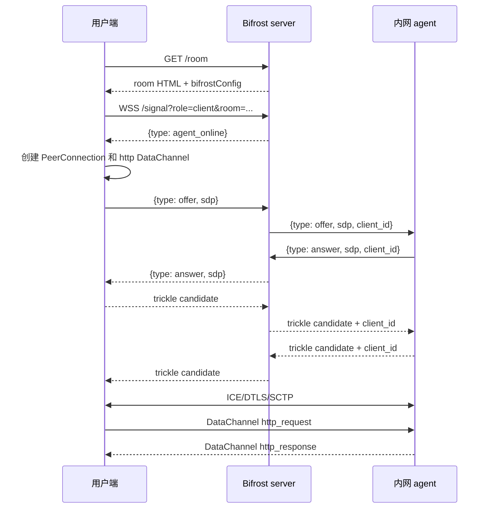

# Bifrost 用户端协议与跨平台实现指南

本文描述 Bifrost 当前版本的用户端协议。这里的“用户端”是浏览器、命令行工具、Android/iOS 应用或 Windows 桌面程序等访问内网服务的一端；它不是内网中的 `bifrost-client` agent。

本文不依赖任何特定编程语言。实现者只需要选择平台上的 WebSocket、WebRTC PeerConnection、DataChannel、HTTP 和 TLS 库，并按照本文的消息格式连接各组件。

## 1. 总体结构

一次访问包含四个层次：

```text
用户端
  |
  | HTTPS/WSS：登录、获取 ICE 配置、交换 SDP/ICE
  v
Bifrost server
  |
  | 仅转发信令 JSON，不转发业务 HTTP 数据
  v
内网 client agent
  |
  | 普通 HTTP/HTTPS
  v
内网目标服务
```

WebRTC 建立完成后，业务数据通常沿用户端和内网 client 之间的 PeerConnection 传输。server 只负责把信令消息从一方转给另一方；如果 ICE 选择 TURN relay，数据包会经过 TURN，但仍由 WebRTC 的 DTLS/SCTP 保护，server 不解析业务 JSON。

用户端不需要内网 client 的 Ed25519 私钥。Ed25519 challenge-response 是 agent 注册 server 时使用的机器身份认证；用户端使用 room 页面登录得到的 Cookie 访问受保护 room。

## 2. 协议栈与地址

从外到内的协议栈如下：

| 层 | 协议 | 作用 |
| --- | --- | --- |
| server 页面 | HTTP/HTTPS | 获取 room 配置，必要时提交密码 |
| 信令 | WebSocket，文本帧 | 传输 `agent_online`、SDP 和 ICE candidate |
| P2P 传输 | WebRTC ICE + DTLS + SCTP | 在用户端和 agent 之间建立安全连接 |
| 业务通道 | WebRTC DataChannel，二进制帧 | 传输分包的请求和响应（兼容传统纯文本 JSON 帧） |
| 业务编码 | 二进制封包 (4 字节 Header 长度 + JSON Header + Raw Body) | 高效传输 HTTP 方法、headers 及原始二进制 body（无需 Base64 转换） |
| 内网访问 | HTTP/HTTPS | agent 访问其配置的本地目标 |

假设 server 地址为：

```text
https://bifrost.example.com:8443
```

则用户端使用：

- room 页面：`https://bifrost.example.com:8443/<room>`
- 信令 WebSocket：`wss://bifrost.example.com:8443/signal?role=client&room=<room>`

纯 HTTP 部署时对应使用 `http://` 和 `ws://`。生产环境必须验证 HTTPS/WSS 证书；关闭 TLS 校验只适合临时测试。

`room` 当前只允许 1--64 个 ASCII 字母、数字、`.`、`_`、`-`，且必须以字母或数字开头。HTTP 请求中的 `path` 不包含 room 前缀，例如访问 room `home` 下的 `/healthz` 时，DataChannel 里发送 `/healthz`，而不是 `/home/healthz`。

## 3. 获取 room 配置

### 3.1 公共 room

先发送：

```http
GET /home HTTP/1.1
Host: bifrost.example.com:8443
```

成功时返回 HTTP 200 的 HTML 页面。当前 server 没有单独的 JSON 配置接口，用户端应从页面中读取如下 JavaScript 常量：

```js
const bifrostConfig = {
  "room": "home",
  "path": "/",
  "protected": false,
  "iceServers": []
};
```

实际页面还包含 UI 代码，但 `bifrostConfig` 的值是 JSON 对象。跨平台实现不需要执行页面中的 JavaScript，只需要解析这个对象。

`iceServers` 的结构与 WebRTC 标准 `RTCConfiguration.iceServers` 对应。`urls` 可以是单个字符串，也可以是字符串数组：

```json
[
  {"urls": ["stun:stun.example.com:3478"]},
  {
    "urls": ["turn:turn.example.com:3478?transport=udp"],
    "username": "bifrost",
    "credential": "turn-secret"
  }
]
```

传给 PeerConnection 时应保留 `urls`、`username` 和 `credential`。没有 STUN/TURN 时使用空数组，PeerConnection 只尝试 host candidate。

### 3.2 受保护 room

受保护 room 的首次 `GET /home` 返回 HTTP 401 和一个 HTML 表单。表单中有三个隐藏字段：

```text
room
next
login_token
```

用户端提交：

```http
POST /_bifrost/login HTTP/1.1
Content-Type: application/x-www-form-urlencoded

room=home&next=%2Fhome&login_token=<token>&password=<password>
```

具体值必须按表单 HTML 转义规则进行 URL 编码。登录成功时 server 返回 3xx，并通过 `Set-Cookie` 设置当前 room 的 session Cookie。用户端必须保存 Cookie，然后再次请求 `GET /home` 获取包含 `bifrostConfig` 的页面。

不要把 `password_hash` 当作用户密码提交。`password_hash` 只存在于 agent 注册信令中，用户端只提交用户实际输入的 room 密码。

随后建立 WSS 时必须携带刚才保存的 Cookie。没有有效 Cookie 时，WebSocket 握手会返回 HTTP 401；room 未注册或 agent 尚未在线时通常返回 HTTP 409。

## 4. WebSocket 信令

### 4.1 建立信令连接

配置解析和登录完成后，连接：

```text
wss://bifrost.example.com:8443/signal?role=client&room=home
```

WebSocket 使用文本帧承载 JSON。连接成功后，server 首先发送：

```json
{"type":"agent_online"}
```

收到这个消息后才开始创建 SDP offer。它表示 room 当前有可用 agent，不表示 WebRTC 已经建立。

用户端可以不发送 `Origin`。如果发送，当前 server 要求它的 scheme 和 host 与请求 server 相同。

### 4.2 server 的路由规则

server 为每一个用户端 WebSocket 分配一个内部 `client_id`。用户端不需要生成或填写它。

| 方向 | server 行为 |
| --- | --- |
| 用户端 -> server -> agent | 复制 JSON，增加内部 `client_id` |
| agent -> server -> 用户端 | 根据 `client_id` 找到用户端，转发前删除 `client_id` |

因此用户端看到的消息不会包含 `client_id`。不要把另一个连接的 `client_id` 复制到自己的消息中。

### 4.3 SDP offer/answer

用户端创建一个普通的、非 negotiated 的可靠 DataChannel，label 使用 `http`，然后创建 offer。等本地 SDP 设置完成后发送：

```json
{
  "type": "offer",
  "sdp": {
    "type": "offer",
    "sdp": "v=0\r\n...完整 SDP..."
  }
}
```

server 把它转给 agent。agent 创建 answer 后，用户端收到：

```json
{
  "type": "answer",
  "sdp": {
    "type": "answer",
    "sdp": "v=0\r\n...完整 SDP..."
  }
}
```

用户端把 `sdp` 设置为远端描述。SDP 是 WebRTC 库生成和解析的黑盒，不要手工改写 `m-line`、fingerprint、ICE 参数或 candidate。

### 4.4 ICE candidate

用户端 PeerConnection 产生本地 candidate 时，发送 trickle 消息：

```json
{
  "type": "candidate",
  "candidate": {
    "candidate": "candidate:...",
    "sdpMid": "0",
    "sdpMLineIndex": 0,
    "usernameFragment": "optional"
  }
}
```

agent 发回的 candidate 结构相同。不同 WebRTC SDK 对 candidate 字符串是否包含 `candidate:` 前缀的表示可能略有差异；接收端应使用 SDK 的 candidate parser，并接受标准 SDK 输出，而不是自己按空格拆字段。

实现时要处理 candidate 的竞态：

1. answer 尚未收到时到达的远端 candidate，先放入队列。
2. 设置远端 answer 后，再把队列中的 candidate 加入 PeerConnection。
3. answer 后到达的 candidate 直接加入 PeerConnection。
4. 用户端自己的 candidate 事件可能早于信令发送循环，应该暂存到 WebSocket 建立后发送。

即使本地 SDP 已包含 host candidate，也建议实现 trickle candidate，因为 STUN/TURN candidate 可能异步产生。

### 4.5 DataChannel 建立

用户端必须创建 DataChannel，而不是等待 agent 创建：

```text
label       = "http"
negotiated  = false
ordered     = true（使用平台默认值即可）
```

等收到 DataChannel `open` 事件后再发送业务消息。收到 SDP answer 只表示信令阶段完成，不表示 DataChannel 已经可用。

一个完整连接的时序如下：



## 5. HTTP 封包协议

DataChannel 采用二进制封包格式（兼容传统 UTF-8 纯文本 JSON 帧）。封包结构由 4 字节大端整数长度前缀、JSON 头部和紧随其后的原始 Body 字节流组成：

```text
+-----------------------+-----------------------------+-----------------------+
|  Header Length (uint) |       Header (JSON UTF-8)   |       Body (Bytes)    |
|        4 Bytes        |        header_len Bytes     |         rest          |
+-----------------------+-----------------------------+-----------------------+
```

该设计消除了 Base64 编解码产生的 ~33% 带宽膨胀与 CPU 损耗。如果请求或响应没有 body（例如常规 GET 请求或 204 无内容响应），Header 之后没有额外的 Body 字节。

### 5.1 用户端 -> agent：HTTP 请求

二进制封包的 Header JSON：

```json
{
  "type": "http_request",
  "id": 42,
  "method": "POST",
  "path": "/api/items?verbose=1",
  "headers": {
    "accept": "application/json",
    "content-type": "application/json"
  }
}
```

紧随 Header JSON 之后附加原始 Body 字节流（例如 `{"name":"demo"}` 对应的 15 字节）。

Header 字段说明：

| 字段 | 必需 | 说明 |
| --- | --- | --- |
| `type` | 是 | 固定为 `http_request` |
| `id` | 是 | 用户端生成的关联 ID；响应必须原样返回。整数或字符串都适合，单个 DataChannel 内必须唯一 |
| `method` | 是 | HTTP 方法，建议使用大写 ASCII token |
| `path` | 是 | 以 `/` 开头的路径和 query string；不要包含 fragment、scheme、host 或 room 前缀 |
| `headers` | 是 | JSON 对象，key/value 都是字符串；没有 header 时发送 `{}` |

> [!NOTE]
> 向后兼容说明：agent 端亦兼容旧版纯文本 JSON 帧。如果收到纯文本 JSON 且包含 `body_base64` 字段，仍可自动解码并转发。

agent 收到后使用自己的 service 配置拼接目标地址：

```text
<configured scheme>://<configured host>:<configured port><path>
```

用户端不应发送或依赖 `Host`、`Content-Length`。当前 agent 会丢弃这两个 header，由底层 HTTP 库重新生成。其他 header 会尽量转发，包括自定义 header、Cookie、Authorization 等。

请求不会经过分块流式传输；当前协议要求 agent 收齐一个完整 DataChannel 封包消息后才开始访问内网 HTTP 服务。实现者应为 JSON 开销预留空间，单条消息不要接近 WebSocket/DataChannel 的缓冲区上限。当前没有 HTTP body chunk/stream 协议，超大文件需要另行设计扩展。

### 5.2 agent -> 用户端：HTTP 响应

二进制封包的 Header JSON：

```json
{
  "type": "http_response",
  "id": 42,
  "status": 201,
  "status_text": "Created",
  "headers": {
    "content-type": "application/json",
    "content-length": "16"
  },
  "response_url": "/api/items?id=1"
}
```

紧随 Header JSON 之后附加原始响应 Body 字节流。

Header 字段说明：

| 字段 | 必需 | 说明 |
| --- | --- | --- |
| `type` | 是 | 固定为 `http_response` |
| `id` | 是 | 对应请求的 `id` |
| `status` | 是 | 最终 HTTP status code |
| `headers` | 是 | 响应 headers 对象 |
| `status_text` | 否 | reason phrase，例如 `OK`、`Created` |
| `response_url` | 否 | agent HTTP session 最终 URL 的 path/query |
| `error` | 否 | agent 转发失败时的错误描述 |

agent 的 HTTP session 默认跟随重定向，并缓存在一个 room 的 client 生命周期中。因此 `response_url` 可能与原始 `path` 不同；同一个 room 后续请求可能复用内网服务设置的 Cookie。用户端应按 `status` 判断 HTTP 结果，不要只判断 DataChannel 是否收到响应。

转发异常通常映射为 `status: 502`，同时带有 `error` 字段。HTTP 404、401、500 等来自内网服务的正常响应仍会作为对应 status 原样返回，不属于协议错误。

### 5.3 并发与关联

agent 会为每个 DataChannel 消息异步创建转发任务，所以多个请求可以同时发送，响应顺序不保证。用户端必须用 `id` 关联响应，而不能依赖发送顺序。

如果 DataChannel 断开，所有未完成请求都应失败并由上层决定是否重建整个 PeerConnection。不要在旧 DataChannel 上继续发送。

## 6. 可选的 WebSocket 转发协议

如果跨平台客户端还要支持内网页面的 WebSocket，可以复用同一个 `http` DataChannel。HTTP 请求响应使用 `id`，WebSocket 消息使用 `socket_id` 区分连接。

### 打开

```json
{
  "type": "websocket_open",
  "socket_id": "socket-1",
  "path": "/events?room=local",
  "protocols": ["chat.v1"]
}
```

成功：

```json
{
  "type": "websocket_opened",
  "socket_id": "socket-1",
  "protocol": "chat.v1"
}
```

失败：

```json
{
  "type": "websocket_open_failed",
  "socket_id": "socket-1",
  "error": "..."
}
```

`path` 必须是单一相对路径，不能以 `//` 开头、不能含 `#` 或控制字符。`protocols` 是去重后的 WebSocket subprotocol token 数组。

### 收发消息

文本帧：

```json
{
  "type": "websocket_send",
  "socket_id": "socket-1",
  "data_type": "text",
  "data": "hello"
}
```

二进制帧（使用二进制封包，Header 之后附带原始二进制数据）：

Header JSON:
```json
{
  "type": "websocket_send",
  "socket_id": "socket-1",
  "data_type": "binary"
}
```
紧随其后附带原始二进制 Payload 字节。

agent 发回二进制帧：

Header JSON:
```json
{
  "type": "websocket_message",
  "socket_id": "socket-1",
  "data_type": "binary"
}
```
紧随其后附带原始二进制 Payload 字节。

> [!NOTE]
> 兼容性说明：如果使用旧版文本 JSON 发送二进制帧，仍支持 `data_type: "binary"` 配合 Base64 编码的 `data` 字符串。

### 关闭

```json
{
  "type": "websocket_close",
  "socket_id": "socket-1",
  "code": 1000,
  "reason": "done"
}
```

关闭事件：

```json
{
  "type": "websocket_closed",
  "socket_id": "socket-1",
  "code": 1000,
  "reason": ""
}
```

当前允许的主动关闭码是 `1000`、`1001` 或 `3000--4999`；reason 的 UTF-8 长度不能超过 123 bytes。WebSocket 二进制数据直接传输原始字节流，无 Base64 开销。

## 7. 连接关闭、重连与异常

用户端应同时监控 WebSocket、PeerConnection、ICE 和 DataChannel 状态：

- HTTP WebSocket 握手 401：缺少或过期的 room session，需要重新登录。
- HTTP WebSocket 握手 409：room 没有在线 agent，稍后重试。
- 信令 WebSocket 关闭 1012：agent 重连或 server 侧重置，旧 PeerConnection 不可复用。
- 信令 WebSocket 关闭 1008：受保护 room 的 session 失效，重新获取页面并登录。
- room/server 变化导致的关闭可能使用 1013。
- ICE `failed`、PeerConnection `failed` 或 DataChannel `closed`：关闭旧 PeerConnection、清理未完成请求，然后从 room 配置和新的 WebSocket 开始完整重连。

agent 下线时 server 会关闭对应用户端连接；用户端不应只重建 DataChannel，而应重新建立信令和 PeerConnection。重连时必须重新检查 room 页面和 session，因为 agent 重新注册后 room 密码策略也可能变化。

建议设置分级重试间隔，例如 1、2、4、8、16 秒，并在网络恢复事件触发时立即尝试一次。WebSocket 库应支持正常 ping/pong；长时间没有业务请求时也不能因为本地网络设备回收空闲连接而误判为业务成功。

## 8. 跨平台实现流程

下面是与语言无关的伪代码。所有异步操作都应绑定超时和取消逻辑：

```text
function connect(room, server):
    page = HTTPS_GET(server + "/" + room)

    if page.status == 401:
        form = parse_login_form(page.body)
        cookie = POST_LOGIN(form, password)
        page = HTTPS_GET(server + "/" + room, cookie)

    config = parse_bifrost_config(page.body)
    ws = OPEN_WEBSOCKET(server.websocket_scheme + "/signal",
                        query={role: "client", room: room},
                        cookie=cookie)
    assert RECEIVE_JSON(ws).type == "agent_online"

    pc = CREATE_PEER_CONNECTION(config.iceServers)
    dc = pc.CREATE_DATA_CHANNEL("http", negotiated=false)

    pc.on_local_ice_candidate = function(candidate):
        if candidate != null:
            SEND_JSON(ws, {type: "candidate", candidate: candidate.toJSON()})

    ws.on_message = function(message):
        if message.type == "answer":
            pc.SET_REMOTE_DESCRIPTION(message.sdp)
            ADD_QUEUED_REMOTE_CANDIDATES(pc)
        else if message.type == "candidate":
            if pc.has_remote_description:
                pc.ADD_ICE_CANDIDATE(message.candidate)
            else:
                queue_remote_candidate(message.candidate)

    dc.binary_type = "arraybuffer"
    dc.on_message = function(raw_data):
        header, body = decode_packet(raw_data)
        dispatch_response_by_id(header, body)
    dc.on_open = mark_ready

    offer = pc.CREATE_OFFER()
    pc.SET_LOCAL_DESCRIPTION(offer)
    SEND_JSON(ws, {type: "offer", sdp: pc.local_description})
    WAIT_UNTIL(dc.is_open)

function encode_packet(header, body_bytes):
    header_bytes = UTF8_ENCODE(JSON_STRINGIFY(header))
    return UINT32_BE(LEN(header_bytes)) + header_bytes + body_bytes

function decode_packet(data_bytes):
    header_len = UINT32_BE_DECODE(data_bytes[0:4])
    header = JSON_PARSE(UTF8_DECODE(data_bytes[4:4 + header_len]))
    body = data_bytes[4 + header_len:]
    return header, body

function request(method, path, headers, bytes):
    id = next_unique_id()
    packet = encode_packet({
        type: "http_request",
        id: id,
        method: UPPER_ASCII(method),
        path: path,
        headers: headers
    }, bytes)
    SEND_DATA_CHANNEL_BYTES(packet)
    response_header, response_body = WAIT_FOR_RESPONSE_ID(id)
    return response_body
```

不同 WebRTC SDK 的 API 名称和 candidate 生命周期不同，但上述顺序不可省略。特别是：

1. DataChannel 必须由用户端创建，因为 agent 端等待远端 `datachannel` 事件。
2. offer 必须包含 DataChannel 的 SCTP 协商信息。
3. answer 设置完成后才能安全处理排队的远端 candidate。
4. 只有 DataChannel `open` 后才能发送 `http_request`。
5. 业务请求必须等待 `id` 对应的响应，而不是等待下一条任意消息。

### 平台注意事项

- Android：需要处理网络切换、应用进入后台和 UDP 防火墙；不要把 WebRTC 线程阻塞在 UI 线程。
- iOS：需要遵守后台网络和 VoIP/后台执行限制；应用从后台恢复后应检查 PeerConnection 状态，必要时完整重连。
- Windows：本地防火墙可能阻止 ICE UDP；WSS 的系统证书验证和代理设置要显式处理。
- 所有平台：优先使用成熟的 libwebrtc/WebRTC 原生绑定，不要自行实现 ICE、DTLS、SCTP 或 SDP parser。

## 9. 安全边界

- 默认验证 server 的 HTTPS/WSS 证书；不要在生产环境使用“跳过证书验证”。
- room 密码只通过 HTTPS/WSS 保护的登录流程提交。不要把密码、session Cookie 或 TURN credential 写入普通日志。
- room 页面中的 `iceServers` 可能包含 TURN credential。它们是给用户端使用的连接凭据，不能视为秘密 API key；应限制 TURN 配额并定期轮换。
- DataChannel 的 JSON 只应当被当作受保护的传输协议；服务端和 agent 仍需在本地 HTTP 服务层执行授权。
- 不要让用户提供的完整 URL 直接改变 agent 目标 host。用户端只发送 path/query，目标 host、port 和 scheme 必须由 agent 的 service 配置决定。
- HTTP headers 和 body 可能包含敏感数据。即使 server 不解析业务内容，日志、TURN、终端崩溃转储和本地调试器仍可能暴露它们。

## 10. 兼容性清单

一个新的用户端实现至少应通过以下检查：

- 能处理公共和受密码保护 room。
- 能保存登录后的 Cookie，并在 WSS 握手中携带。
- 能解析页面中的 `bifrostConfig.iceServers`，包括 STUN、TURN、字符串 URL 和 URL 数组。
- 能发送和接收 SDP answer 以及 trickle ICE candidate。
- 能处理 answer 之前到达的 candidate。
- 能创建名为 `http` 的非 negotiated DataChannel。
- 能打包和解包二进制 packet 协议（4 字节大端 header 长度 + JSON header + 原始 body 字节），且二进制响应字节完全一致。
- 能处理响应乱序、HTTP 非 2xx、空 body、二进制响应和 502 转发错误。
- 能在 DataChannel、ICE、PeerConnection 或信令 WebSocket 断开后清理旧连接并完整重连。
- 如果实现 WebSocket 转发，能正确区分文本帧、二进制帧、`socket_id`、协议和关闭码。

当前 wire message 没有单独的版本字段或能力协商字段。实现者应保持未知字段可忽略、已知字段类型稳定；如果未来增加大文件分片、流式响应或新的认证方式，建议引入新的 `type` 或显式协议版本，而不要改变现有字段含义。
